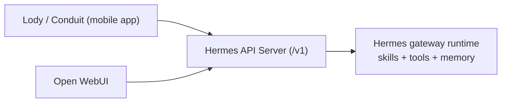

# VPS Setup for Open WebUI + Lody/Conduit

This guide implements a production layout for:

- **Hermes on VPS** as the core agent runtime
- **Open WebUI** as the web UI layer
- **Lody / Conduit** as OpenAI-compatible clients
- **24/7 uptime** using managed services instead of foreground shells

If you want Hermes agent capabilities (tools, skills, memory, workflows), clients must connect to the **Hermes API Server** (directly or via Open WebUI), not to the subscription proxy.

## Target Architecture



## 1) Update Hermes First

On your VPS:

```bash
hermes update
hermes config check
hermes config migrate
```

This ensures your runtime and config schema are current before enabling API-facing services.

## 2) Enable Hermes API Server (required)

Use `hermes config set` so secrets route into `~/.hermes/.env` correctly:

```bash
hermes config set API_SERVER_ENABLED true
hermes config set API_SERVER_KEY "replace-with-strong-random-secret"
hermes config set API_SERVER_HOST 127.0.0.1
hermes config set API_SERVER_PORT 8642
hermes config set API_SERVER_MODEL_NAME "Hermes Agent"
```

Then restart the gateway runtime:

```bash
hermes gateway restart
```

Validate:

```bash
curl -s http://127.0.0.1:8642/health
curl -s -H "Authorization: ******" \
  http://127.0.0.1:8642/v1/models
```

## 3) Install Open WebUI as the middle UI

Hermes ships an automation script:

```bash
cd "${HERMES_HOME:-$HOME/.hermes}/hermes-agent"
bash scripts/setup_open_webui.sh
```

This script configures API server env vars, installs Open WebUI, creates a reusable launcher, and installs a user service when available.

For headless Linux without `systemd --user`:

```bash
OPEN_WEBUI_ENABLE_SERVICE=false bash scripts/setup_open_webui.sh
```

## 4) Connect Lody / Conduit correctly

### Mode A — app supports OpenAI-compatible API directly

Point app settings to Hermes API Server:

- Base URL: `https://<your-domain>/v1` (or `http://<vps-ip>:8642/v1` in private network testing)
- API Key: same value as `API_SERVER_KEY`
- Model: `API_SERVER_MODEL_NAME` (or profile name if default behavior is used)
- Streaming: enabled

### Mode B — app uses Open WebUI as primary frontend

1. Log in to Open WebUI
2. In Open WebUI connections, set Hermes API Server URL + API key
3. Use Open WebUI as the app/backend entry

## 5) 24/7 uptime (no foreground-only deployment)

### Hermes gateway runtime

Use managed service mode on server:

```bash
sudo hermes gateway install --system
sudo hermes gateway start --system
sudo hermes gateway status --system
```

Fallbacks like `tmux`/`nohup` are fine for temporary sessions, but not your primary production reliability layer.

### Open WebUI runtime

Use one of:

- `systemd` / `launchd` via `scripts/setup_open_webui.sh`
- Docker with `--restart always`

## 6) OpenHands integration

Hermes already includes the optional OpenHands skill surface (`optional-skills/autonomous-ai-agents/openhands/`).

Install and use it through Hermes skills flow:

```bash
hermes skills install official/autonomous-ai-agents/openhands
```

Once installed, calls from Lody/Conduit/Open WebUI that reach Hermes can trigger the same skill-driven capability.

---

## Required Information Sheet (fill this before deployment)

### A) Host

- VPS public domain: `_______`
- VPS public IP: `_______`
- SSH user: `_______`
- OS version: `_______`

### B) Hermes API Server

- `API_SERVER_ENABLED=true`
- `API_SERVER_HOST=_______` (recommended internal bind: `127.0.0.1`)
- `API_SERVER_PORT=_______` (default: `8642`)
- `API_SERVER_KEY=_______` (strong random secret)
- `API_SERVER_MODEL_NAME=_______` (for example: `Hermes Agent`)

### C) Open WebUI (if used)

- Open WebUI URL: `https://_______`
- Open WebUI admin account: `_______`
- Open WebUI -> Hermes Base URL: `http://_______:_______/v1`
- Open WebUI -> Hermes API key: `_______` (must match `API_SERVER_KEY`)

### D) Lody / Conduit app (OpenAI-compatible fields)

- Base URL: `https://_______/v1` or `http://_______:_______/v1`
- API key: `_______`
- Model: `_______`
- Streaming: `on/off` (recommended: `on`)

### E) Hermes provider/model

- Provider: `_______` (Nous/OpenRouter/OpenAI/...)
- Model: `_______`
- Required provider keys configured: `yes/no`

## Security and exposure notes

- Keep `API_SERVER_KEY` secret; rotate if leaked.
- Prefer binding API server to loopback and exposing through an authenticated reverse proxy.
- Do not expose Open WebUI or Hermes API directly to public internet without transport security and auth controls.

## Related Docs

- [Open WebUI integration](/user-guide/messaging/open-webui)
- [API Server](/user-guide/features/api-server)
- [Subscription Proxy](/user-guide/features/subscription-proxy)
- [Messaging Gateway](/user-guide/messaging)
